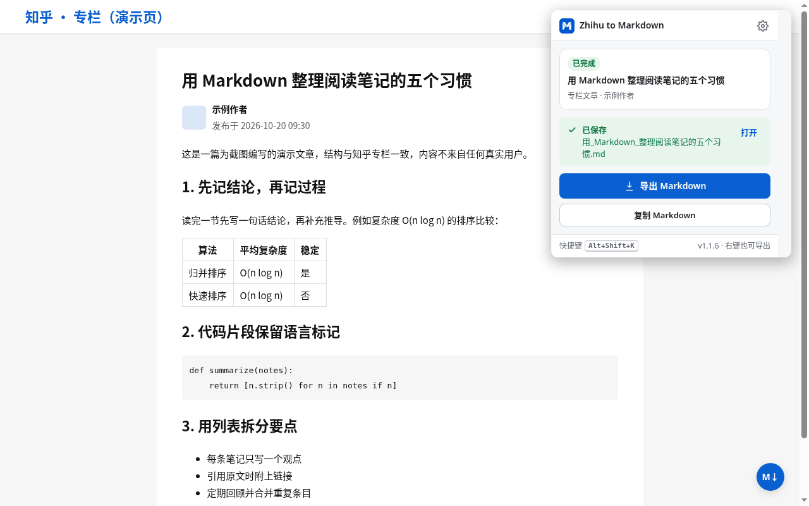
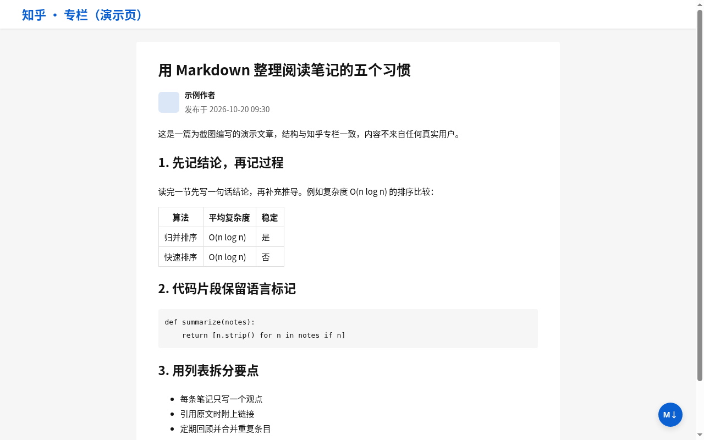
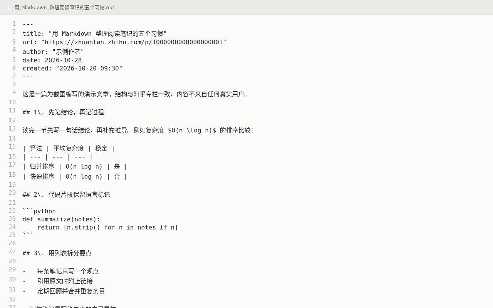
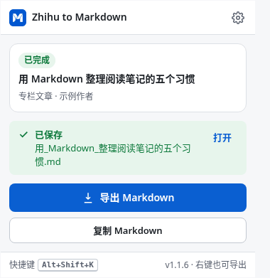
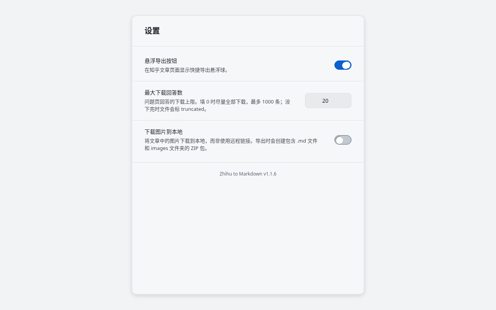

<div align="center">


# Zhihu to Markdown

**将知乎专栏/问答页面内容转换为 Markdown 格式并下载**

[](https://chromewebstore.google.com/detail/zhihu-md/heeilejdelmogpbnbbhdokgfabmhkenh)
[](./LICENSE)
[](./manifest.src.json)

[安装](https://chromewebstore.google.com/detail/zhihu-md/heeilejdelmogpbnbbhdokgfabmhkenh) · [English](./README.en.md) · [使用说明](./docs/usage.md) · [常见问题](./docs/troubleshooting.md) · [隐私说明](./PRIVACY.md) · [更新日志](./CHANGELOG.md)

<picture>
  <source media="(prefers-color-scheme: dark)" srcset="docs/screenshots/hero-dark.png">
  
</picture>

</div>

> 截图中的文章是演示页，不是真实知乎内容。

## 功能

- **专栏、回答一键导出**：生成带 YAML Front Matter 的单个 Markdown 文件。
- **问题页批量导出**：通过知乎回答接口继续往后取回答，默认 20 条，最多 1000 条（填更大的数也按 1000 条算）；没取完时文首写 `truncated: true`。
- **首页推荐、关注动态、热榜导出**：整理成按条目组织的清单型 Markdown。
- **格式尽量保留**：标题层级、列表、引用；公式转 `$...$` / `$$...$$`；代码块保留并尝试识别语言；表格转 Markdown 表格；链接卡片降级为普通链接。
- **图片可打包**：开启「下载图片到本地」后，专栏、回答和问题页的下载导出会生成含 `images/` 目录的 ZIP。
- **复制 Markdown**：弹窗、悬浮球（右键）、右键菜单都能把 Markdown 复制到剪贴板，也可以只复制选中内容。
- **页面悬浮球**：可拖拽、靠边停靠、记住位置，可在设置里关闭。
- **最近导出**：弹窗里列出最近导出记录（标题、成功与否、时间）；刚保存的文件可一键在文件夹中显示。
- 浅色、深色模式都支持。

不是爬虫：只处理你打开的知乎页面，以及用你当前的登录状态向知乎自己的接口补取的、页面上还没显示的回答；不绕过登录或付费限制，默认不抓评论区。

| 页面悬浮球 | 导出的 Markdown |
| --- | --- |
|  |  |

### 支持的页面

| 页面 | URL 示例 | 结果 |
| --- | --- | --- |
| 专栏文章 | `https://zhuanlan.zhihu.com/p/...` | 单个 Markdown（或 ZIP） |
| 单条回答 | `https://www.zhihu.com/question/.../answer/...` | 单个 Markdown（或 ZIP） |
| 问题页 | `https://www.zhihu.com/question/...` | 多个回答，按顺序分节 |
| 首页推荐 | `https://www.zhihu.com/` | 信息流清单 |
| 关注动态 | `https://www.zhihu.com/follow` | 信息流清单 |
| 热榜 | `https://www.zhihu.com/hot` | 排名、标题、链接、热度 |

## 安装

**Chrome**：从 [Chrome 应用商店](https://chromewebstore.google.com/detail/zhihu-md/heeilejdelmogpbnbbhdokgfabmhkenh) 安装，需要 Chrome 121 或更高版本。

**Edge / Firefox**：计划中，尚未上架。

**从源码加载**：

```bash
git clone https://github.com/Tendo33/zhihu-md.git
cd zhihu-md
npm install
npm run build
```

打开 `chrome://extensions`，开启「开发者模式」，点击「加载已解压的扩展程序」，选择 `dist/` 目录。

## 使用

1. 打开一个支持的知乎页面。
2. 点击页面右下角的悬浮球，或点击工具栏图标后选「导出 Markdown」。
3. 想直接粘贴到编辑器里，选「复制 Markdown」。

| 入口 | 说明 |
| --- | --- |
| 工具栏弹窗 | 显示页面类型、标题、作者；「导出 Markdown」「复制 Markdown」；最近导出 |
| 悬浮球 | 左键下载，右键复制；问题页、信息流、热榜优先用它 |
| 快捷键 | 导出本页。1.1.7 起新安装默认 `Alt+Shift+K`（macOS 为 `Option+Shift+K`）。从旧版本升级时，已经分配过的快捷键（如 `Alt+Shift+Z`）保持不变，不会被自动改成 K；以前没有分配到快捷键的用户，升级后 Chrome 可能补上 K。实际生效的快捷键以弹窗底栏显示为准。如需修改，或快捷键被其他扩展占用、被浏览器保留，请到 `chrome://extensions/shortcuts` 设置 |
| 右键菜单 | 「导出本页为 Markdown」「复制本页为 Markdown」；选中文字时「复制选中内容为 Markdown」；知乎链接上「导出链接的知乎页面为 Markdown」 |



弹窗触发的长导出（如问题页批量）需要保持弹窗打开，直到下载开始；用悬浮球没有这个限制。

## 设置



| 设置项 | 说明 | 默认 |
| --- | --- | --- |
| 悬浮导出球 | 是否显示页面右下角悬浮球 | 开启 |
| 最大下载条数 | 问题页和信息流的条数上限。最多 1000，填更大的数按 1000 算。0 表示上限内不限：问题页按页面显示的回答总数取，信息流滚到没有新卡片为止，都最多 1000 条；没下完时文首写 `truncated: true` | 20 |
| 下载图片到本地 | 专栏、回答、问题页的下载导出打包为 ZIP；复制、信息流和热榜仍用远程图片 | 关闭 |

设置保存在 `chrome.storage.sync`（开启浏览器同步时会随你的浏览器账号同步），悬浮球位置和最近导出记录保存在 `chrome.storage.local`。

## 权限说明

| 权限 | 用途 |
| --- | --- |
| `activeTab` | 读取你当前打开的知乎页面 |
| `clipboardWrite` | 你选择「复制」时把 Markdown 写入剪贴板 |
| `contextMenus` | 提供右键菜单入口 |
| `downloads` | 把 Markdown 或 ZIP 保存到本地 |
| `storage` | 保存设置、悬浮球位置和最近导出记录 |
| `*.zhihu.com` | 在知乎页面运行；问题页批量导出时请求知乎回答接口 |
| `https://*.zhimg.com` | 知乎图片 CDN；开启「下载图片到本地」时下载文中图片打包 |

所有权限都在安装或更新时一次授予，使用时不会再弹出确认或授权请求。

## 隐私

- 扩展没有自己的服务器，会读取知乎页面内容，仅在本地处理，不上传给开发者或第三方；除了向知乎及其图床发出的正常请求，不发出其他网络请求，没有统计或埋点。
- 设置存在 `chrome.storage.sync`，开启浏览器同步时会随你的浏览器账号同步。这是浏览器自己的同步，只有设置，不含页面内容。
- 只访问知乎及其图片 CDN（`zhimg.com`，仅在打包图片时），所有转换都在你的浏览器里完成。
- 详见 [PRIVACY.md](./PRIVACY.md)。

## 常见问题

**付费、折叠或未展开的内容能导出吗？**
取决于当前页面是否已显示。扩展不绕过任何限制。

**问题页为什么没有全部回答？**
受「最大下载条数」限制（默认 20）。设为 0 时最多 1000 条，填大于 1000 的数也按 1000 条算；接口失败时只保留页面上已出现的回答。

**快捷键不起作用？**
到 `chrome://extensions/shortcuts` 检查 Zhihu to Markdown 是否已分配快捷键。

**知乎改版后导出出错？**
批量导出依赖页面结构，请提 Issue，附上页面类型和 URL。

更多见 [docs/troubleshooting.md](./docs/troubleshooting.md)。

## 开发

```bash
npm install
npm run build     # 输出未打包扩展到 dist/
npm run lint
npm test
npm run package   # 生成 build/zhihu-to-markdown-v<version>.zip
```

文档入口：[docs/README.md](./docs/README.md)，包括 [架构](./docs/architecture.md)、[导出链路](./docs/request-lifecycle.md)、[开发维护](./docs/development.md)。

## 更新日志

见 [CHANGELOG.md](./CHANGELOG.md)。

## License

[MIT](./LICENSE)
