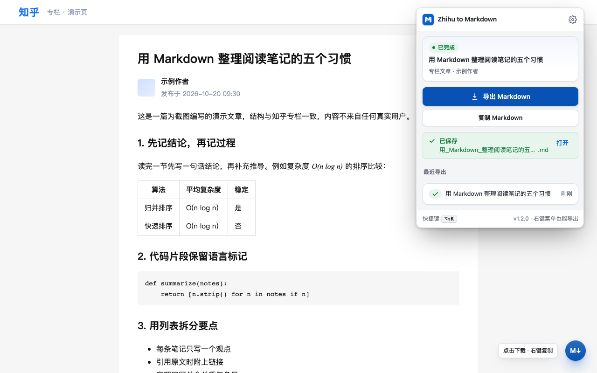
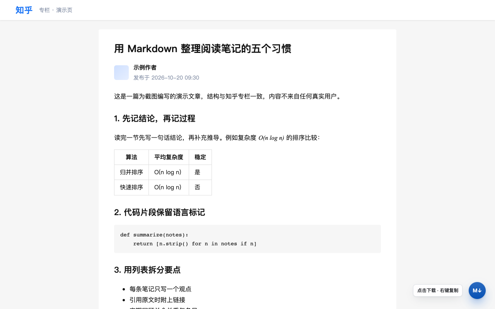
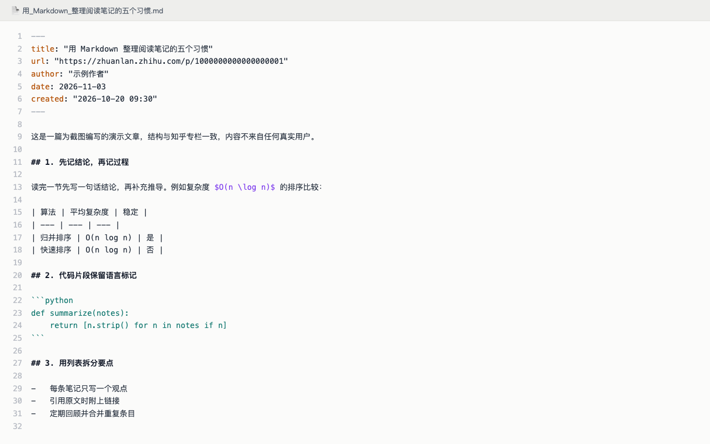
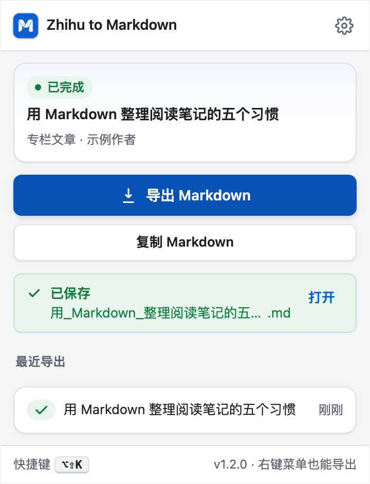
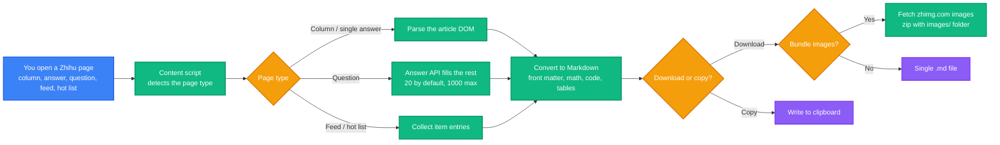
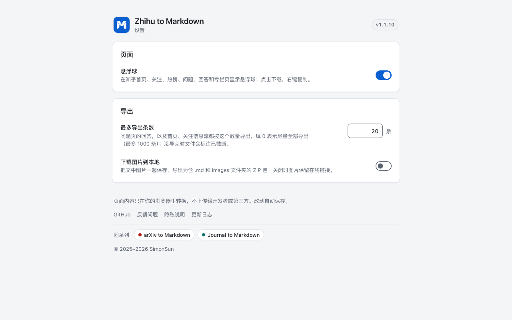

<div align="center">


# Zhihu to Markdown

**Save Zhihu articles, answers, questions and the hot list as Markdown in one click.**

[](https://chromewebstore.google.com/detail/zhihu-md/heeilejdelmogpbnbbhdokgfabmhkenh)
[](manifest.src.json)
[](package.json)
[](package.json)

[](https://chromewebstore.google.com/detail/zhihu-md/heeilejdelmogpbnbbhdokgfabmhkenh)
[](LICENSE)
[](PRIVACY.md)

[Install](https://chromewebstore.google.com/detail/zhihu-md/heeilejdelmogpbnbbhdokgfabmhkenh) · [Usage](#usage) · [Export flow](#how-an-export-runs) · [Settings](#settings) · [FAQ](#faq)

<sub>[中文](README.md) · English</sub>

<picture>
  <source media="(prefers-color-scheme: dark)" srcset="docs/screenshots/hero-dark.png">
  
</picture>

</div>

> **The "to Markdown" series**: [arXiv to Markdown](https://github.com/Tendo33/arxiv-md) · **Zhihu to Markdown** · [Journal to Markdown](https://github.com/Tendo33/journal-md). Three extensions with the same interface and export habits, for arXiv preprints, Zhihu and journal full text.

> The UI is in Chinese only. The article in the screenshots is a demo page, not real Zhihu content.

## Features

- **Columns and answers**: one Markdown file with YAML front matter.
- **Question pages in bulk**: keeps fetching answers through Zhihu's answer API; 20 by default, up to 1000 (larger numbers count as 1000). If it stops early, the file gets `truncated: true`.
- **Home feed, Following and Hot list**: exported as item-by-item list documents.
- **Formatting kept**: headings, lists, quotes; math as `$...$` / `$$...$$`; fenced code with language detection; tables; link cards become plain links.
- **Optional image bundling**: with "下载图片到本地" on, downloads of columns, answers and question pages become a ZIP with an `images/` folder.
- **Copy Markdown**: from the popup, the floating ball (right-click) or the context menu; you can also copy just the selection.
- **Floating ball**: draggable, snaps to the edge, remembers its position; can be turned off.
- **Recent exports** in the popup (title, status and time); the file you just saved can be shown in its folder with one click.
- Light and dark themes.

Not a crawler: it only handles the Zhihu page you opened, plus answers not yet shown on the page that it fetches from Zhihu's own API with your current login. It does not bypass login or paywalls, and skips comments.

| Floating ball | Exported Markdown |
| --- | --- |
|  |  |

### Supported pages

| Page | Example URL | Result |
| --- | --- | --- |
| Column article | `https://zhuanlan.zhihu.com/p/...` | One Markdown file (or ZIP) |
| Single answer | `https://www.zhihu.com/question/.../answer/...` | One Markdown file (or ZIP) |
| Question | `https://www.zhihu.com/question/...` | Many answers, one section each |
| Home feed | `https://www.zhihu.com/` | Feed list |
| Following | `https://www.zhihu.com/follow` | Feed list |
| Hot list | `https://www.zhihu.com/hot` | Rank, title, link, heat |

## Install

**Chrome**: install from the [Chrome Web Store](https://chromewebstore.google.com/detail/zhihu-md/heeilejdelmogpbnbbhdokgfabmhkenh). Requires Chrome 121+.

**Edge / Firefox**: planned, not yet listed.

**From source**:

```bash
git clone https://github.com/Tendo33/zhihu-md.git
cd zhihu-md
npm install
npm run build
```

Open `chrome://extensions`, enable Developer mode, click "Load unpacked" and pick `dist/`.

## Usage

1. Open a supported Zhihu page.
2. Click the floating ball, or the toolbar icon and then 导出 Markdown (Export Markdown).
3. To paste into an editor, use 复制 Markdown (Copy Markdown).

| Entry point | What it does |
| --- | --- |
| Toolbar popup | Page type, title, author; Export / Copy Markdown; recent exports |
| Floating ball | Left-click downloads, right-click copies; preferred for question, feed and hot pages |
| Shortcut | Exports the current page. Defaults to `Alt+Shift+K` (`Option+Shift+K` on macOS); the popup footer shows the one in effect. Change it at `chrome://extensions/shortcuts` |
| Context menu | "Export this page as Markdown", "Copy this page as Markdown"; on selected text, "Copy selection as Markdown"; on a Zhihu link, "Export linked Zhihu page as Markdown" |



Long exports started from the popup (such as a question page) need the popup to stay open until the download starts. The floating ball has no such limit.

## How an export runs

An export goes from page content to a file on disk through a handful of extension modules:



## Settings



| Setting | Description | Default |
| --- | --- | --- |
| 悬浮球 (floating button) | Show the floating ball | On |
| 最多导出条数 (max items) | Limit for question pages and feeds. Max 1000; larger numbers count as 1000. 0 means no limit within the cap: as many answers as the question page lists, or scroll until no new cards on feeds, up to 1000 either way; files that stop early get `truncated: true` | 20 |
| 下载图片到本地 (download images) | Bundle images into a ZIP for column, answer and question downloads; copy, feed and hot exports keep remote images | Off |

Settings live in `chrome.storage.sync` (synced with your browser account when browser sync is on); the ball position and recent exports in `chrome.storage.local`.

## Permissions

| Permission | Why |
| --- | --- |
| `activeTab` | Read the Zhihu page you are on |
| `clipboardWrite` | Put Markdown on the clipboard when you choose Copy |
| `contextMenus` | Right-click menu items |
| `downloads` | Save Markdown or ZIP files |
| `storage` | Settings, ball position and recent exports |
| `*.zhihu.com` | Run on Zhihu pages; call Zhihu's answer API for question pages |
| `https://*.zhimg.com` | Zhihu's image CDN; download images when "download images" bundling is on |

All permissions are granted once at install or update time; the extension never asks for confirmation or extra permissions while you use it.

## Privacy

- No backend and no analytics. Page content is converted in your browser and never uploaded to the developer or third parties. The extension only talks to Zhihu and its image CDN (`zhimg.com`, only when bundling images).
- Settings are stored in `chrome.storage.sync` and sync with your browser account when browser sync is on. That covers settings only, never page content.
- See [PRIVACY.md](./PRIVACY.md).

## FAQ

**Can it export paid, folded or collapsed content?**
Only if the page already shows it. Nothing is bypassed.

**Why are some answers missing on a question page?**
The max-items limit (20 by default). Set 0 for up to 1000; numbers above 1000 count as 1000. If the API fails, only answers already on the page are kept.

**The shortcut does nothing.**
Check `chrome://extensions/shortcuts`.

**Exports broke after a Zhihu redesign.**
Bulk exports depend on page structure. Please open an issue with the page type and URL.

More in [docs/troubleshooting.md](./docs/troubleshooting.md).

## Development

```bash
npm install
npm run build     # unpacked extension in dist/
npm run lint
npm test
npm run package   # build/zhihu-md-v<version>-chrome.zip, -firefox.zip, and SHA256SUMS.txt
```

Developer docs (Chinese) start at [docs/index.md](./docs/index.md), including [architecture](./docs/architecture.md) and [export pipeline](./docs/request-lifecycle.md), plus [development and maintenance](./docs/development.md).

## Also in the series

| Extension | For | Get it |
| --- | --- | --- |
| [arXiv to Markdown](https://github.com/Tendo33/arxiv-md) | arXiv papers (abstract, PDF and HTML pages) | [Chrome Web Store](https://chromewebstore.google.com/detail/arxiv-to-markdown/pphdggfbjddgdljndgdablkhbdpbfnbd) |
| **Zhihu to Markdown** | Zhihu articles, answers, questions, feeds, hot list | [Chrome Web Store](https://chromewebstore.google.com/detail/zhihu-md/heeilejdelmogpbnbbhdokgfabmhkenh) |
| [Journal to Markdown](https://github.com/Tendo33/journal-md) | PMC, PubMed, Springer, Nature, Frontiers, MDPI, PLOS, eLife | [Releases](https://github.com/Tendo33/journal-md/releases) |

## Changelog

See [CHANGELOG.md](./CHANGELOG.md).

## License

[MIT](./LICENSE)
